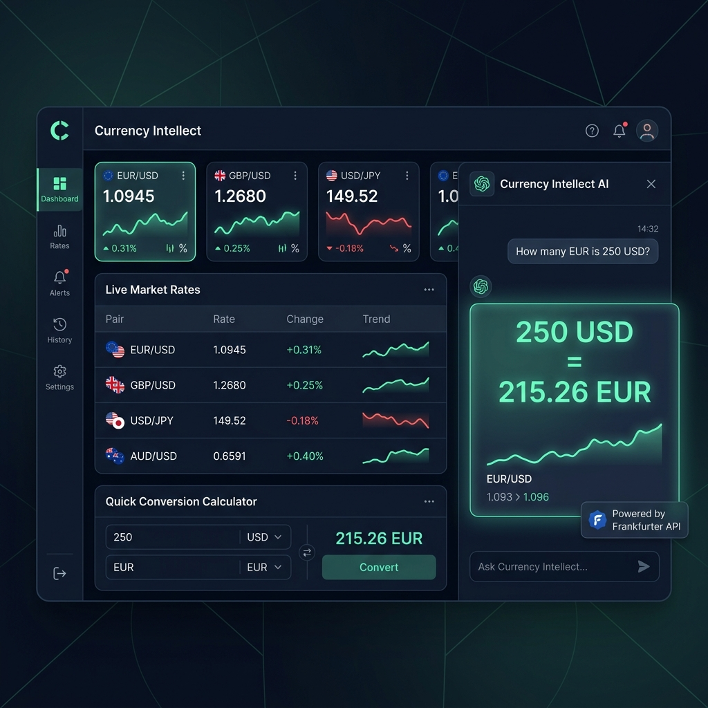
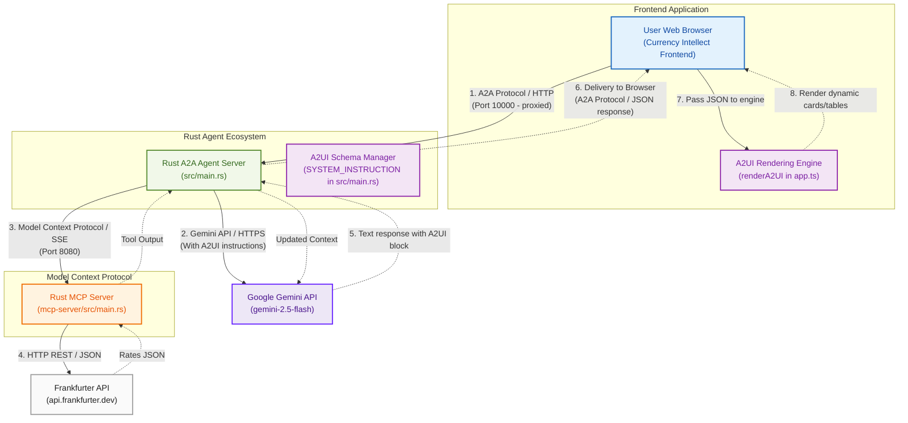

# 💵💱💶 Currency Agent (Rust + Frontend + A2UI 1.0)

[](LICENSE)

A high-performance sample agent demonstrating Rust + Model Context Protocol (MCP) + Agent-to-User Interface (A2UI) working together.



## A2UI 1.0: Express and Server-Side Macros in Rust

This copy of `currency-agent-rust-agui` runs on [A2UI 1.0](https://a2ui.org). The official agent SDKs are Python, TypeScript and Dart, so the Express format and server-side macros are ported to Rust in `src/express/`, following the Python SDK `a2ui-agent-sdk` 0.11.0.

- **Express compiler and response parser** (`src/express/syntax.rs`, `normalize.rs`, `catalog.rs`, `compiler.rs`, `response.rs`). The model writes compact `<a2ui>` blocks; the agent compiles them into A2UI 1.0 messages against the v1.0 Basic catalog, the currency charts catalog and the macro catalog.
- **Server-side macros** (`src/express/macros.rs`, `src/currency_ui.rs`). `RateCard(from, to, amount)` and `RateHistoryChart(from, to, days)` are components the model calls in one line. The Rust server fetches the rates from the Frankfurter API and expands each call into Basic `Card`/`Column`/`Text`/`Divider` and the custom `LineChart`, so rate figures never pass through the model. Currency codes are checked and the day count clamped before any request.
- **Prompt** (`src/express/prompt.rs`). The Express contract and the positional signatures are generated from the catalogs. The 1,200-line hand-written v0.9 JSON schema prompt in `src/main.rs` is gone.
- **React UI.** Each compiled block reaches the browser as `<a2ui-json>[...]</a2ui-json>` and is rendered by `@a2ui/react` 0.15.0 with `@a2ui/web_core/v1_0` (`frontend-react/src/components/A2uiMessages.tsx`), in the chat and in the dashboard viewport. CopilotKit's A2UI middleware speaks v0.9, so it is turned off.

#### Conformance

The upstream Express conformance suites from the `python/a2ui-agent-sdk/v0.11.0` release are vendored in `tests/a2ui_conformance/` (Apache-2.0) and run with `cargo test --test express_conformance -- --nocapture`:

| Suite | Passed | Known gaps |
|---|---|---|
| `agent/express/compiler.yaml` | 132 of 135 | 3 cases that load a v0.9 catalog; the port targets v1.0 only |
| `agent/express/response_parser.yaml` | 38 of 38 | none |

Not ported: the streaming parser, the decompiler, Direct JSON and the experimental formats. After macro expansion, messages are checked structurally (catalog, required and declared properties, child ids) rather than against the full JSON Schema.

`cargo test --test currency_ui -- --ignored` runs the two macro tests that call the live Frankfurter API.

#### Measured on 2026-11-11 (`gemini-2.5-flash`, one run each)

| Request | Path | Result |
|---|---|---|
| USD to JPY trend, last 30 days | AG-UI, direct to the agent | `RateHistoryChart` card with line chart, 2.1 s |
| How much is 250 USD in EUR? (follow-up turn) | React UI | `RateCard`: 250.00 USD = 224.68 EUR |
| Convert 1500 CAD to USD | A2A `message/send` | `RateCard`: 1,500.00 CAD = 1,053.76 USD |

The vanilla `frontend/` was not migrated or tested against 1.0 messages.

## Overview

The Currency Agent project showcases the capabilities of a pure compiled Rust backend and high-performance, responsive client-side Web UIs. It is a multi-protocol agent system that converts currencies, fetches real-time rates, and streams rich, interactive user interfaces in real-time.

### 🔑 Key Protocols & Ecosystem

1. **Model Context Protocol (MCP):** 
   Standardizes how the agent integrates tools. Our Rust MCP server (`mcp-server/src/main.rs`) exposes `get_exchange_rate` on port `8080`, calling the [Frankfurter API](https://www.frankfurter.dev/) for real-time rates.
2. **Agent-to-Agent (A2A) Protocol:** 
   Standardizes metadata exchange and communication between agent servers.
3. **Agent-to-User Interface (A2UI):** 
   Defines the schema for rich UI blocks (cards, rates tables, charts) generated by the agent and parsed dynamically by the frontend client.
4. **AG-UI:** 
   Ecosystem wrapper linking the UI client to the backend agent server.

---

## 🏗️ Architecture



For more comprehensive architectural and component breakdown, see [architecture_diagram.md](architecture_diagram.md).

---

## 🎨 Dual Frontend User Interfaces

Our project provides two distinct user interfaces for interacting with the Currency Agent:

1. **Vanilla TS Frontend (A2UI Dashboard):**
   * Located at `frontend/frontend/`.
   * A premium glassmorphic dashboard that natively parses and renders **A2UI** component JSON blocks (Cards, Tables, and Charts) from `<a2ui-json>` elements.
   * Runs on port `4173`.
2. **React Frontend (CopilotKit Companion):**
   * Located at `frontend-react/`.
   * A high-fidelity Next.js application equipped with Tailwind CSS and CopilotKit for interactive, copilot-driven chat features.
   * Runs on port `3000`.

---

## 🛠️ Interactive A2UI Demo Sandbox

We built an **A2UI Demo Sandbox** inside the Vanilla TS frontend. You can experience the premium glassmorphic A2UI elements render live **without** requiring active Google GenAI API keys or running any background servers.

To launch the sandbox:
1. **Install dependencies:** `make frontend-install`
2. **Build and preview:** `make frontend`
3. **Open browser:** Navigate to `http://localhost:4173`
4. Click **Demo 1: A2UI Conversion Card** or **Demo 2: A2UI Rates Table** on the welcome screen to view pre-loaded, live mockup renderings.

See [a2ui_mockup_demo.md](a2ui_mockup_demo.md) for full details on sandbox integration and components.

---

## 🚀 Getting Started (Live Flow)

### Prerequisites

* [Rust / Cargo](https://www.rust-lang.org/tools/install)
* Node.js & npm (for building and serving the frontends)
* Google GenAI API Key (from [Google AI Studio](https://aistudio.google.com/apikey))

### Configuration

Create a `.env` file in the root directory:

```env
GOOGLE_API_KEY=your_gemini_api_key_here
GOOGLE_GENAI_USE_VERTEXAI=FALSE
GENAI_MODEL=gemini-2.5-flash
```

### Local Commands (Makefile)

Manage all services using the provided `Makefile`. To view all available commands:

```bash
make help
```

#### 1. Quick Install
Install all node dependencies and compile Rust binaries:
```bash
make install
```

#### 2. Start Services (Background)
Launch both the Rust MCP Server (port `8080`) and the Rust Currency Agent (port `10000`):
```bash
make start
```
Check status or logs:
```bash
make status
tail -f agent.log
tail -f mcp.log
```

#### 3. Run the Vanilla TS Dashboard (A2UI Live Rendering)
```bash
make frontend
```
Navigate to `http://localhost:4173` in your browser. Ask the agent to convert currencies (e.g., `"convert 100 USD to EUR"`).

#### 4. Run the React Next.js Copilot UI
```bash
make react-ui
```
Navigate to `http://localhost:3000` in your browser.

#### 5. Stop All Services
```bash
make stop
```

---

## 🧪 Testing

Run compiling, background process launching, test client queries, and clean teardown in one command:

```bash
make test
```

## 📄 License

This project is licensed under the Apache 2.0 License - see the [LICENSE](LICENSE) file for details.
