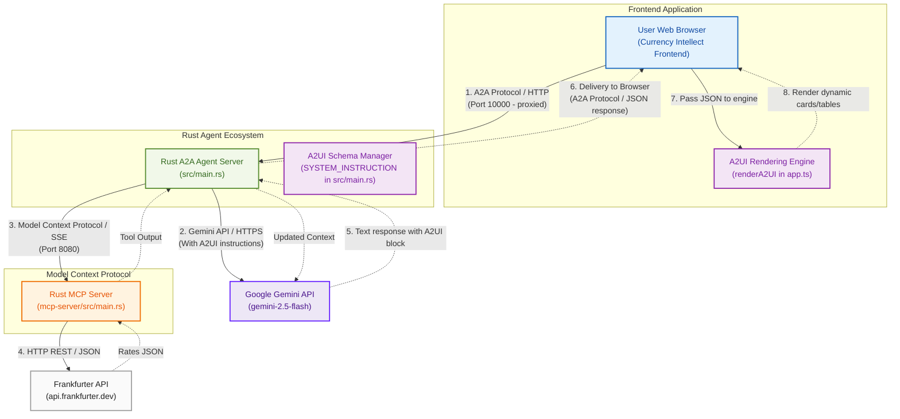

# Currency Agent Architecture & Protocols (with A2UI)

Below is a visual flow of interactions between the user-facing workspace frontend, the compiled Rust Agent, the Gemini LLM, the local Model Context Protocol (MCP) server, and the external data source:

## Architecture Diagram (Mermaid)

Below is the Mermaid flowchart representation of the architecture:

---

## Detailed Components & Protocols

### 1. Agent-to-Agent (A2A) Protocol
*   **Source:** [app.ts](file:///home/xbill/currency-agent-rust/frontend/frontend/app.ts)
*   **Destination:** [main.rs](file:///home/xbill/currency-agent-rust/src/main.rs)
*   **Port:** Default `10000` (or `8080` in Cloud Run env)
*   **Protocol Details:** 
    *   Vite dev server proxies `/api` requests to the compiled Axum-based Rust Agent Server.
    *   Uses standard HTTP/JSON payloads to register, exchange, and resolve agent metadata cards.
    *   Supports conversation context propagation using `contextId`.

### 2. Google Gemini API Protocol
*   **Source:** [main.rs](file:///home/xbill/currency-agent-rust/src/main.rs)
*   **Destination:** Google GenAI Gemini endpoint
*   **Protocol Details:**
    *   Secured via `GOOGLE_API_KEY` (Gemini API) or Google Cloud Service Account credentials (Vertex AI).
    *   Uses standard HTTPS JSON payloads.
    *   Communicates model instructions, user prompts, conversation history, and handles function/tool-calling schemas returned by the model.
    *   The primary model used is `gemini-2.5-flash`.

### 3. Model Context Protocol (MCP)
*   **Source:** [main.rs](file:///home/xbill/currency-agent-rust/src/main.rs)
*   **Destination:** [main.rs](file:///home/xbill/currency-agent-rust/mcp-server/src/main.rs)
*   **Port:** Default `8080` (endpoint `/mcp`)
*   **Protocol Details:**
    *   Standardizes tool exposure and execution schema under the **Model Context Protocol** spec.
    *   Communicates over HTTP using Server-Sent Events (SSE).
    *   The MCP Server advertises the available tool (`get_exchange_rate`) and receives tool execution requests containing parameters (e.g. `currency_from`, `currency_to`, `currency_date`).

### 4. HTTP REST/JSON API Protocol
*   **Source:** [main.rs](file:///home/xbill/currency-agent-rust/mcp-server/src/main.rs)
*   **Destination:** Frankfurter API (`https://api.frankfurter.dev`)
*   **Protocol Details:**
    *   Standard HTTP GET request using standard Rust async client (`reqwest`).
    *   Fetches real-time market data in standard JSON format containing exchange rates.

### 5. Agent-to-UI (A2UI) Protocol & Integration
*   **Source:** `SYSTEM_INSTRUCTION` schema definition inside [main.rs](file:///home/xbill/currency-agent-rust/src/main.rs)
*   **Destination:** [app.ts](file:///home/xbill/currency-agent-rust/frontend/frontend/app.ts) (runs in user's browser)
*   **Protocol Details:**
    *   Defines standard JSON schemas for rich, interactive, and responsive UI components (e.g. Cards, Tables, Text fields, Columns, Rows).
    *   The Rust Agent Server injects system prompt instructions instructing the Gemini model on component schemas.
    *   The model generates structured layout descriptions wrapped in `<a2ui-json>` elements.
    *   The TS frontend client parses responses via regex for `<a2ui-json>...</a2ui-json>`, then uses the `renderA2UI()` engine to map JSON components directly to glassmorphic, stylized HTML container elements.

